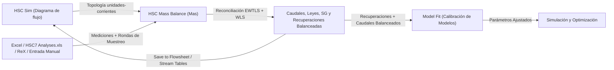
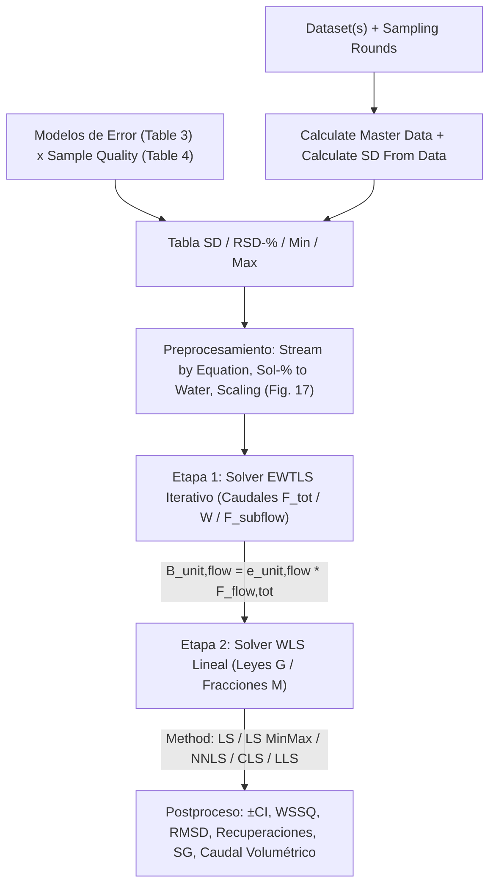

# Análisis de Ingeniería Inversa (REA) — Módulo 20: Mass Balance

## 1. Inventario de Artefactos Fuente

| Artefacto | Alcance Observado | Contenido Relevante |
|---|---|---|
| [51-mass-balance.md](file:///home/nando/Documentos/Docs%20HSC/51-mass-balance/51-mass-balance.md) | `1036` líneas (`51.1–51.8`) | Flujo completo, tablas `1–4`, ecuaciones `(1)–(29)`, mensajes `51.6`, bibliografía `51.8` |
| [51-mass-balance.pdf](file:///home/nando/Documentos/Docs%20HSC/51-mass-balance/51-mass-balance.pdf) | `39` páginas (Antti Remes, Jaana Tommiska, Pertti Lamberg, 2023-09-05) | Versión maestra maquetada del capítulo 51 |
| Directorio `imagenes/` | `34` archivos PNG (`Imagen pegada.png` .. `Imagen pegada (34).png`) | Capturas oficiales equivalentes a `Figs. 1–28` y catálogo gráfico de iconos (`51.5`) |

---

## 2. Descomposición de Dominio y Topología de Ciclo de Vida

El módulo **Mass Balance** actúa como eslabón central entre el modelado topológico en **HSC Sim** y la calibración fenomenológica (*Model Fit*):

### Ejes Estructurales Observados

1. **Matriz de Alcance (`Tabla 1` de `51.2`):** el problema de balance se define en el producto cartesiano de `4` tipos de dato (`Solids only`, `Assays only`, `Solids and assays`, `Solids, water and assays`) × `3` niveles granulométricos (`Unsized`, `Sized` sin análisis por malla, `Sized by Assay`).
2. **Grafo Bipartito de Incidencia $e_{\text{flow}}^{\text{unit}} \in \{-1, 0, +1\}$:**
   - Convención en formulaciones matemáticas `51.7` (`Eq. 2`, `Eq. 10`): entrada a la unidad $+1$ y salida $-1$ (como en `Fig. 24`, hoja `Flowsheet`), satisfaciendo $e^{\text{unit}} \cdot F = 0 \iff \sum_{\text{in}} F = \sum_{\text{out}} F$.
   - Cada unidad posee el atributo booleano **`Size Transforming`** (unidad reductora de tamaño, p.ej. molinos SAG/bolas o chancadores): su activación excluye el balance de conservación por fracción granulométrica sobre dicha unidad (`Eqs. 13, 14, 21`).
   - Cada corriente posee **`Type`** (`Unknown`, `Solids/Slurry`, `Liquid/Water`), **`Flows`** (habilita balance de flujo), **`Assays`** (habilita balance de leyes), **`Sampling Device`** y **`Sample Quality`** (`Good`, `Moderate`, `Bad`), más relación lineal opcional **`Stream by Equation`** ($F_i = c \cdot F_j$, p.ej. `2 * RC1` en `Fig. 12`).
3. **Separación de Variables por Naturaleza Física (`Tabla 2` de `51.4.2`):**
   - `SF`: flujo total de sólidos (`t/h`, `g`) — un único rol principal por balance.
   - `SC`: flujo de componente sólido (agua/líquido u otro flujo de componente directo, convertido o independiente en etapa de agua).
   - `A`: ley elemental/química de sólidos (`%`, `g/t`, `ppm`).
   - `M`: ley mineralógica (`%`, vinculada a matriz estequiométrica mineral y gravedad específica sólida `SG`).
   - `SA`: porcentaje en peso retenido/pasante de fracción de tamaño (`%`).
   - `SP`: porcentaje de sólidos en pulpa (`%`), acoplado con agua mediante `Eq. (7)`.
   - `Info`: variable informativa excluida del sistema numérico de reconciliación.

---

## 3. Arquitectura Lógica del Motor en Dos Etapas

La arquitectura observada separa estrictamente la preparación estadística de datos, la estimación no lineal de caudales (*EWTLS*) y el ajuste lineal de concentraciones (*WLS*):

### Decisiones de Diseño Clave Observadas

- **Desacoplamiento Caudal–Ley (*Two-Stage Reconciliation*):** evita resolver simultáneamente el sistema bilineal completo en una sola jacobiana gigante cuando existen decenas de elementos/minerales y fracciones. Primero converge $F_{\text{tot}}$ con iteraciones de mínimos cuadrados totales ponderados por elemento (*EWTLS*, Markovsky et al. 2006) usando leyes escaladas y tolerancia relativa (`Balance Tolerance`, defecto `0.001`), y luego resuelve leyes $G$ en un sistema cuadrático convexo exacto con restricciones lineales `B * G = 0` (`LS`, `NNLS`, `CLS`).
- **Manejo de Subdeterminación al Imponer `Sum = 100`:** como señala `51.7` (`Eqs. 11` y `29`), si se impone simultáneamente conservación exacta sobre las $N_U$ unidades y la restricción $\sum_c G_c = 100$ en todas las corrientes, la matriz de restricciones de igualdad resulta deficiente en rango. La formulación documentada elimina `1` fila de unidad de $B$ (`N_U - 1` filas en `Bulk`, `N_S - 1` subflujos en `Sized by Assay`) para restaurar rango completo.
- **Estado y Trazabilidad Celda a Celda (`51.4.3`):** el estado previo (`Missing`, `Measured`, `Guesstimated`, `Fixed`, `Excluded`) controla qué incógnitas son libres, fijas con varianza nula o ignoradas; el estado posterior (`Balanced`, `Calculated`, `Non Available/backcalculated`) clasifica cada celda resultado e alimenta las gráficas de torta de `Data Status` (`Fig. 10`).

---

## 4. Formatos de Intercambio e Integración

| Formato / Canal | Dirección | Especificación Observada |
|---|---|---|
| Proyecto HSC Sim en memoria / `.Sim` | Bidireccional | Lectura automática de unidades/corrientes (`Save to Flowsheet`, `Stream Tables`, `Enter Recoveries`) |
| Respaldo `.HSCMas` | Lectura / Escritura | Archivo autónomo del libro de balance completo (`Backup ▾`) |
| Libro Excel HSC7 `Analyses.xls` | Importación | Hojas `Flowsheet` (matriz de incidencia `A1=Units`, `+1/-1/0`), vertical (`A1=Stream->`, `A2=Source`, `A3=Destination`, sin ensayos por malla) y horizontal (`FractionNo`, `Fraction name`, `Fraction m%`) (`Figs. 24–28`) |
| Datos externos ReX (`Import ReX Data`) | Importación | Importación directa desde repositorio/mediciones HSC ReX (`Fig. 2, 7, 15`) |
| Corrientes `.HSCStream` | Lectura / Escritura | `Import Minerals from Stream` en Variables; `Save Stream As...` en Reporting |
| Portapapeles Tabular / Excel Export | Bidireccional | `Paste Experimental Data` y `Paste SD or RSD Data` con autodetección de orientación horizontal/vertical por cabeceras; `Export to Excel` en `Reporting` |

---

## 5. Auditoría de Brechas en `soryntel`

Inspección directa sobre el repositorio actual `/home/nando/Documentos/HSC-REA/soryntel/`:

1. **Lanzador principal ([main.rs](file:///home/nando/Documentos/HSC-REA/soryntel/crates/soryntel-desktop/src/main.rs#L1010-L1033)):**
   - La baldosa `Bal` (`"Heat & Material\nBalance"`) y la baldosa `Mas` (`"Mass\nBalances"`, línea `1032`) actualmente ejecutan ambas `Act::Launch("balance")`, apuntando al mismo submódulo termoquímico ([balance.rs](file:///home/nando/Documentos/HSC-REA/soryntel/crates/soryntel-thermo/src/balance.rs), [balance_engine.rs](file:///home/nando/Documentos/HSC-REA/soryntel/crates/soryntel-thermo/src/balance_engine.rs)).
   - **Brecha:** falta un modo independiente `--module mass_balance` / `WindowMode::MassBalance` desacoplado de `balance_ui`.
2. **Integración con HSC Sim ([sim_ui/mod.rs](file:///home/nando/Documentos/HSC-REA/soryntel/crates/soryntel-desktop/src/sim_ui/mod.rs#L270-L320) y [sim/model.rs](file:///home/nando/Documentos/HSC-REA/soryntel/crates/soryntel-thermo/src/sim/model.rs#L766)):**
   - El struct `Stream` en `sim/model.rs` ya declara el campo `pub mass_balance: String` (inicializado a `"NO"`), pero el menú `Tools` de `sim_ui` solo incluye `LCA Evaluation...` y `Reports...`; **no existe todavía `Tools -> Mass Balance...`** ni sincronización bidireccional con flujo de trabajo `Sim -> Mas -> Sim`.
3. **Motor Numérico Reutilizable Existente:**
   - [species_converter.rs](file:///home/nando/Documentos/HSC-REA/soryntel/crates/soryntel-thermo/src/species_converter.rs#L520) ya implementa en Rust puro el solver de conjunto activo **Lawson–Hanson NNLS** (`min_{x >= 0} ||M x - y||_2^2`) y la conversión Elemento ↔ Mineral apoyada en [minerals_data.rs](file:///home/nando/Documentos/HSC-REA/soryntel/crates/soryntel-thermo/src/minerals_data.rs).
   - [species.rs](file:///home/nando/Documentos/HSC-REA/soryntel/crates/soryntel-thermo/src/species.rs#L738) implementa `solve_least_squares_qr`.
   - [chem_addin_core/src/stoichiometry.rs](file:///home/nando/Documentos/HSC-REA/soryntel/crates/chem_addin_core/src/stoichiometry.rs#L118) utiliza `nalgebra` SVD, aunque `soryntel-solver` y `soryntel-thermo` actualmente no dependen de `nalgebra` en sus `Cargo.toml`.
   - **Brecha:** no existe todavía el solver **EWTLS** para reconciliación de caudales, ni el wrapper **CLS** con cotas `lb <= x <= ub`, ni **Chebyshev `MinMax`** (Barrodale–Phillips), ni modelos de error `S-shape` / `Whiten` / `Mineral Grade`, ni cálculo de intervalos de confianza `±CI` a partir de la matriz de covarianza aposteriori.
4. **Capacidades Pendientes de Implementación (Resumen):**
   - Nuevo submódulo `soryntel_thermo::sim::mass_balance` (o `soryntel_thermo::mass_balance`) + soporte matricial `EWTLS/WLS/CLS/MinMax`.
   - Persistencia JSON/`.HSCMas` e importadores tabulares horizontal/vertical tipo `Analyses.xls`.
   - Vista completa `soryntel-desktop` (`Balancing Navigator` de `5` grupos, grillas editables con estados de celda y barra de recuperación, `Balance Convergence`, `Parity Chart`, `Reporting`).
