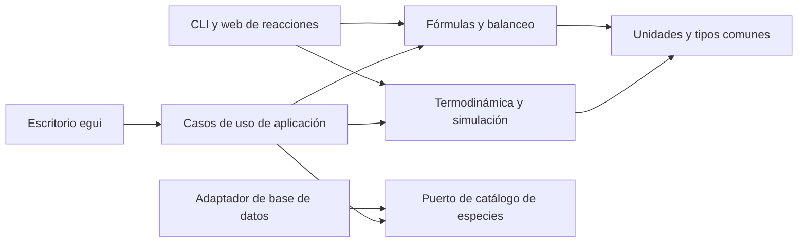

# Arquitectura y mantenimiento

La capa de aplicación concentra casos de uso, aunque hay llamadas directas al dominio en algunas vistas y en CLI/web. La revisión no ha terminado de migrarlas. `chem_addin_core` conserva un segundo motor y parser: hace falta comparar las convenciones de unidades, fases y datos entre ambos antes de unificarlo.

El escritorio tiene un catálogo inicial de textos en `i18n.rs`. Traduzca sólo presentación: no cambie IDs de widgets, fórmulas, nombres de campos serializados, comandos de módulos ni códigos químicos. La búsqueda de literales es una ayuda de inventario, no una demostración de cobertura completa.

Los archivos escritos desde el escritorio pasan por `storage::write_atomic`; el archivo temporal se crea junto al destino. Los guardados de base de datos y otros adaptadores requieren auditoría propia y no se consideran cubiertos por ese cambio.

La validación del contrato público se encuentra en las pruebas de integración de `soryntel-application`. Use datos sintéticos con solución analítica para aislar algoritmos y fuentes independientes para validar propiedades reales. Registre origen, unidades, tolerancia y alcance: una identidad G=H−TS no valida por sí sola H ni S.

La CI ahora ejecuta Cargo. La prueba TCP completa debe ejecutarse en CI; la exclusión local sólo corresponde al sandbox que impide abrir puertos. Los paquetes portables se generan mediante `packaging/package.py`, que evita sobrescribir paquetes ya existentes. La publicación externa no se ha ejecutado durante esta revisión.
