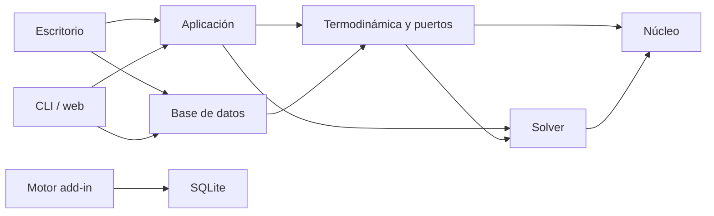

# Auditoría de arquitectura hexagonal del workspace

## Resultado

Las dependencias de las cuatro capas internas apuntan hacia el dominio y no hacia egui ni la base de datos concreta. El workspace tiene ocho crates y conserva infracciones y duplicaciones que impiden describir el proyecto completo como hexagonal sin reservas. Se añadió `scripts/audit-architecture.py` para comprobar las dependencias internas y los adaptadores del módulo 1.

| Crate | Responsabilidad observada | Evaluación |
|---|---|---|
| soryntel-core | Constantes, unidades, errores y tipos comunes | Sin dependencias de UI o base de datos |
| soryntel-solver | Análisis de fórmulas y balanceo | Depende del núcleo; sin infraestructura |
| soryntel-thermo | Modelos y cálculo; define SpeciesRepository/SpeciesCatalogPort | Puerto del catálogo correcto, pero LCA realiza conexiones TCP directamente |
| soryntel-application | Casos de uso sobre dominio y puertos | No depende de adaptadores; algunas firmas requieren el catálogo completo cuando bastaría un puerto menor |
| soryntel-db | Adaptador del catálogo y codecs | Depende del puerto del dominio; elección correcta de dirección. Incluye datos de demostración y datos abiertos |
| soryntel-desktop | Adaptador egui y composición de objetos | Varias vistas aún reciben ThermoDatabase o llaman funciones de dominio directamente. Reacciones ya usa el puerto |
| soryntel-app | CLI/web y composición del catálogo | Reacciones ya pasa por aplicación; servidor HTTP y búsqueda siguen siendo infraestructura de este adaptador |
| chem_addin_core | Motor adicional con parser, cálculo y SQLite | Mezcla persistencia y dominio; duplica funcionalidad y necesita separar puertos/adaptadores antes de reutilizarlo como núcleo |

## Correcciones de esta entrega

- Reacciones deja de importar ThermoDatabase en producción y utiliza SpeciesCatalogPort. La base concreta permanece en la raíz de composición y las pruebas.
- CLI y web pasan balanceo y termodinámica de reacciones por SoryntelApplication.
- Se conserva la manipulación de archivos en el adaptador de escritorio; el dominio genera representaciones y la aplicación expone serialización/exportación. Una llamada de UI a un puerto no supone por sí sola inversión de dependencias incorrecta.

## Infracciones y trabajo propuesto

1. **Prioridad alta: red en dominio LCA.** `BetaLcaState::probe_openlca_ipc` abre TCP, construye HTTP y modifica estado de conexión. Definir un puerto de cliente IPC, implementar transporte en infraestructura y orquestarlo desde aplicación. Debe verificarse respuesta HTTP/JSON-RPC antes de anunciar conexión: actualmente los errores de lectura/escritura se descartan.
2. **Prioridad media: UI acoplada al catálogo concreto.** Migrar los módulos restantes por casos de uso, distinguiendo consulta, edición y persistencia. No sustituir sólo el nombre del tipo si aún se invocan funciones específicas del adaptador.
3. **Prioridad media: motor de add-ins.** Comparar contratos, datos y conversiones con el motor principal; extraer un puerto de persistencia. Evitar unificar ambos por copia de código sin regresiones de compatibilidad.
4. **Prioridad media: puertos grandes y responsabilidades.** SpeciesCatalogPort reúne búsquedas, consulta y edición. Separar interfaces mínimas por necesidad cuando se migren los módulos; evitar fragmentación sin consumidores reales.
5. **Prioridad media: errores y estado.** Separar errores de dominio, errores de transporte y mensajes traducidos. El catálogo actual sólo centraliza una parte de la presentación; los errores anidados aún pueden venir en inglés.
6. **Prioridad media: cálculos largos.** Varias vistas ejecutan cálculo síncrono. Añadir ejecución controlada y cancelación a nivel de aplicación/adaptador para barridos largos, preservando determinismo y propiedad del catálogo.

## Dependencias

Las conexiones de escritorio y CLI a DB incluyen construcción del adaptador. La auditoría distingue esas conexiones de las llamadas concretas dentro de cada vista. El diagrama no implica que las llamadas directas restantes hayan sido migradas.
